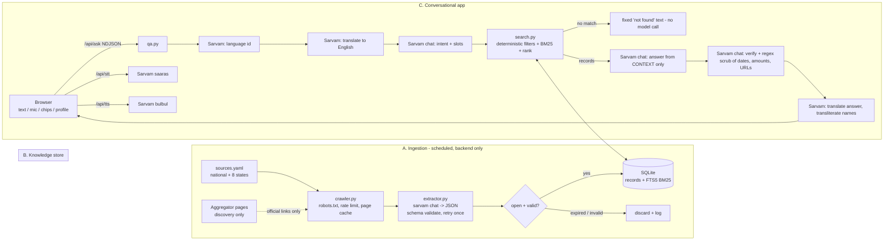

# Architecture

## Rules the code enforces

| Concern | Where |
|---|---|
| Model never answers from memory | `qa.py`: answer prompt gets only retrieved records; no records means a fixed message and **no model call** |
| Eligibility is deterministic | `search.py`: age, category, gender, education, income, state and deadline are plain code |
| Unsupported facts are removed | `qa.unsupported_claims`: every URL, date and money amount in the answer must literally appear in the retrieved records |
| Expired items are not open | `Store.close_expired`, `search.is_open`, `extractor.keep_open` |
| Numbers and names stay exact | `cards.py`: eligibility text is built from structured fields; names are transliterated; dates and URLs are never translated |
| Key stays on the server | `settings.py`; the browser only calls `/api/*` |
| Official sources only | `crawler.is_official`; aggregators are mined for official links only |

## Data flow for one question

1. Detect language, translate to English (cached).
2. Extract slots (type, state, age, category, topic) with the chat model; heuristics fill gaps if the JSON is bad.
3. Merge with the optional profile form (the form wins for personal facts).
4. Search: hard filters, then BM25 ranking blended with profile match, deadline urgency and source confidence.
5. Stream the result cards immediately (translated in parallel), then the answer.
6. Answer is drafted, fact-checked by a second model call, scrubbed by regex, translated, and streamed.
